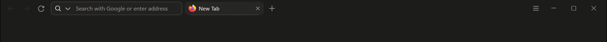
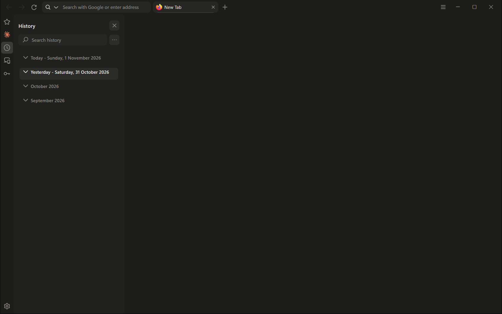
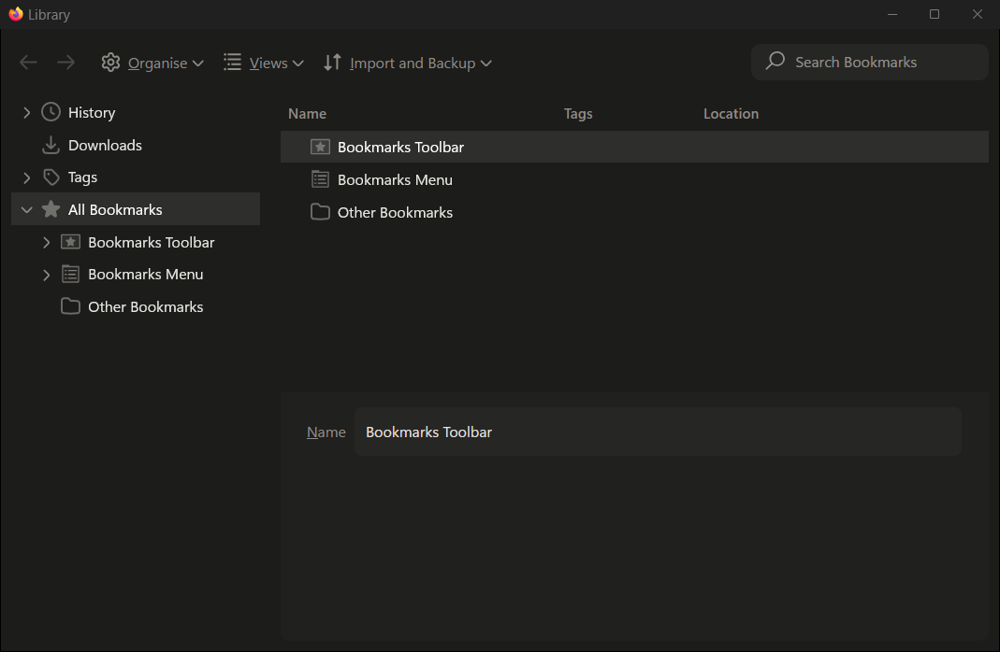

# Firefox themes

Four looks for Firefox, built from `userChrome.css`, `userContent.css` and `user.js`,
plus a switcher that swaps between them and a Windows installer for the main one,
**Minimal Dark**.



Project page and download: <https://thomasalex.in/minimal>

| Folder | Name | Menu bar | Look |
|---|---|---|---|
| `themes/minimal` | Minimal Dark | hidden (Alt shows it) | Flat, colourless graphite in one slim row. The main theme. |
| `themes/xp-classic` | XP Classic | shown | Windows XP |
| `themes/luna-2026` | Luna 2026 | shown | XP re-imagined for 2026 |
| `themes/luna-mac` | Luna + Mac | shown | Luna 2026 with macOS touches |

## Contents

```
themes/        one folder per theme: userChrome.css, userContent.css, user.js, theme.json
scripts/       Switch-Theme.ps1 (Windows switcher), install-windows.ps1, install-mac.sh
installer/     C# sources for "Minimal Firefox Theme Setup.exe" and build.ps1
screenshots/   Minimal Dark: main window, sidebar, Library window, installer
```

## Install

### Windows: the installer (Minimal Dark only)

Download `Minimal Firefox Theme Setup.exe` from <https://thomasalex.in/minimal>, or build it
(see [Installer](#installer)). It backs up the profile's current files first, keeps the
person's own `user.js` settings, can be re-run safely, needs no admin rights, and adds an
entry under **Settings › Apps › Installed apps** whose Uninstall restores Firefox exactly.

It is not code-signed, so SmartScreen says "Windows protected your PC" the first time:
**More info › Run anyway**.

### Windows: all four themes with the switcher

```powershell
powershell -ExecutionPolicy Bypass -File scripts\install-windows.ps1
```

Copies the themes and the switcher into the profile's `chrome\themes\` folder and opens the
switcher. To switch later, run `chrome\themes\Switch-Theme.ps1` in the profile (a desktop
shortcut works well). The switcher closes Firefox the way the X button does (so the session
comes back), copies the theme's files, clears the settings themes manage so the next theme
starts clean, sets the menu bar, and relaunches. From a console:

```powershell
Switch-Theme.ps1 -List
Switch-Theme.ps1 -Theme minimal
Switch-Theme.ps1 -Theme luna-2026 -DryRun
```

### macOS / Linux

```bash
bash scripts/install-mac.sh minimal
```

Quit Firefox first. Copies one theme into the default profile; pass `--profile <path>` for
another (see `about:profiles`). Run it again with another theme name to switch.

## How a theme works

- `userChrome.css` styles the browser itself: tabs, address bar and its dropdown, menus and
  panels, sidebar, Library window, dialogs, permission prompts, tab previews.
- `userContent.css` styles pages Firefox draws: the new tab page, Settings, Add-ons, error
  pages, Firefox View, Private Browsing.
- `user.js` sets the preferences the theme needs, starting with
  `toolkit.legacyUserProfileCustomizations.stylesheets`, which makes Firefox load the two
  CSS files at all.
- `theme.json` gives the switcher a name, description, menu bar setting and sort order.

Firefox reads `chrome/userChrome.css` and `chrome/userContent.css` from the profile folder
and `user.js` from the profile root, at startup only.

## Minimal Dark

### What it does

- **One row.** The address bar sits in the tab strip; ☰ sits at the right, next to the
  window buttons. No menu bar (hold Alt), no extension or account icons, no divider lines.
- **One accent.** A single 1px soft line marks the current tab.
- **Out of the way.** New tabs open blank. Bookmarks live in a bar that slides up when the
  mouse touches the bottom edge. Pinned and top sites drop down from the empty address bar.
  The sidebar strip is off (Ctrl+B opens the sidebar).
- **Everywhere.** Menus, the address dropdown, the ☰ panel, the sidebar, the Library
  window, dialogs and Firefox's own pages get the same flat graphite treatment.
- Subtle motion on hover and open, switched off when Windows animations are off.

| Sidebar | Library window |
|---|---|
|  |  |

### Design tokens

Defined at the top of `themes/minimal/userChrome.css`:

| Token | Value | Use |
|---|---|---|
| `--m-frame` | `#1C1C1B` | window, tab strip |
| `--m-raised` | `#262624` | current tab, address field |
| `--m-popup` | `#222220` | menus, panels, dropdowns |
| `--m-text` | `#E8E6E1` | text |
| `--m-muted` | `#8F8C86` | secondary text, icons |
| `--m-faint` | `#5E5C58` | disabled |
| `--m-accent` | `rgba(255,255,255,0.2)` | the one accent, always one device pixel (`--m-hair`) |

Type is Segoe UI Variable Text at 11.5px in the browser and 13px on Firefox's pages, with
hierarchy by weight. Radii 4 / 8 / 12. Controls are 28px tall in a 36px row.

### Firefox internals it depends on

Written against Firefox 159 on Windows 11. A major Firefox update can move things; these
are the parts most likely to need attention:

- The Nova address bar (`browser.nova.enabled`) and its `--urlbar-*` variables.
- `moz-*` web components (cards, page navigation, buttons): their shadow DOM can only be
  reached through CSS custom properties.
- `@-moz-document url-prefix("chrome://browser/content/sidebar/")` for the sidebar panels
  and `url-prefix("chrome://browser/content/places/places.xhtml")` for the Library window.
- Windows 11 menus: forced to solid, edge-to-edge popups to avoid the Mica dark box.
- Window buttons draw their glyphs with the Segoe Fluent Icons font, which the theme pins
  so its own font doesn't replace it.
- ☰ is placed with `position: fixed`, measured from the window buttons' fixed width.

`themes/minimal/userChrome.css` is split into numbered sections; section 20 is the macOS
variant (☰ at the right edge, room for the traffic lights, the system font).

## Installer

`installer/` holds the sources for `Minimal Firefox Theme Setup.exe`: a small WinForms app
(C# 5, .NET Framework 4) with the theme's three files embedded as resources. Its window uses
the theme's own colours and type.

```powershell
powershell -ExecutionPolicy Bypass -File installer\build.ps1
```

Builds with the `csc.exe` that ships with Windows (nothing to install) into
`installer\dist\` and prints the size and SHA-256. The version is `Engine.Version` in
`Engine.cs` and the assembly version in `Program.cs`. The exe is not committed.

Command-line switches, useful for testing against a scratch profile:
`/silent`, `/uninstall`, `/profile "<path>"`, `/nolaunch`, `/noregister`.

## Known gaps

- **Mac** variant not yet checked on a Mac.
- **Switcher** is Windows only, and reopens Firefox with an extra blank tab.
- Holding Alt can make the menu bar cover ☰.
- Styled but not yet seen on screen: permission prompts, tab previews, error pages,
  Firefox View, private windows.

## Ideas

- Per-site restyles (`@-moz-document domain("wikipedia.org") {...}`), one file per site,
  imported from `userContent.css`.
- An installer option that also installs chosen add-ons from addons.mozilla.org
  (Return YouTube Dislike, Modern for Wikipedia, Enhancer for YouTube).
