<div align="center">

# Minimal for Firefox

**A quieter Firefox.** One slim graphite row, one 1px accent, and nothing else around the page.

[](https://github.com/tomxander/firefox-themes/releases/latest)
&nbsp;
[](https://thomasalex.in/minimal)


[](LICENSE)

<br>

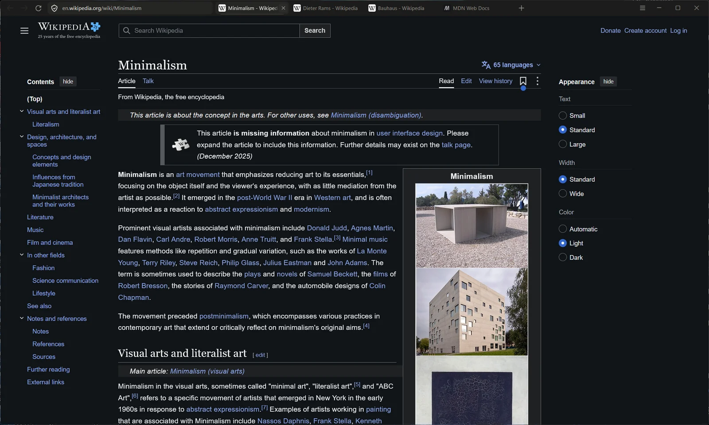

<sub>Minimal Dark on Windows 11 with Firefox 159.</sub>

<br><br>

[What it changes](#what-it-changes) ·
[Gallery](#gallery) ·
[Install](#install) ·
[The other themes](#the-other-themes) ·
[How it's built](#how-its-built) ·
[Installer](#the-installer) ·
[Known gaps](#known-gaps)

</div>

<br>

## What it changes

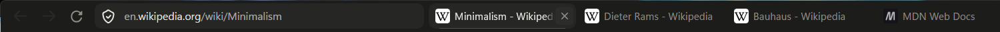

<table>
<tr>
<td width="33%" valign="top">

### One slim row
The address bar moves into the tab strip, and ☰ sits at the far right next to the window buttons. No menu bar (hold <kbd>Alt</kbd>), no extension or account icons, no divider lines.

</td>
<td width="33%" valign="top">

### One accent
The current tab is marked with a single soft hairline, one device pixel thick at any display scaling. Everything else is graphite and warm grey. There is no other colour.

</td>
<td width="33%" valign="top">

### Out of the way
New tabs open blank, so you just start typing. Bookmarks wait below the bottom edge. Pinned sites drop down from the empty address bar. The sidebar is off until you press <kbd>Ctrl</kbd>+<kbd>B</kbd>.

</td>
</tr>
</table>

Every surface gets the same treatment: menus, the address dropdown, the ☰ panel, the sidebar, the Library window, permission prompts, the find bar and Firefox's own pages. Hovering and opening things have subtle motion, which switches off when Windows animation effects are off.

<br>

## Gallery

<table>
<tr>
<td width="50%">
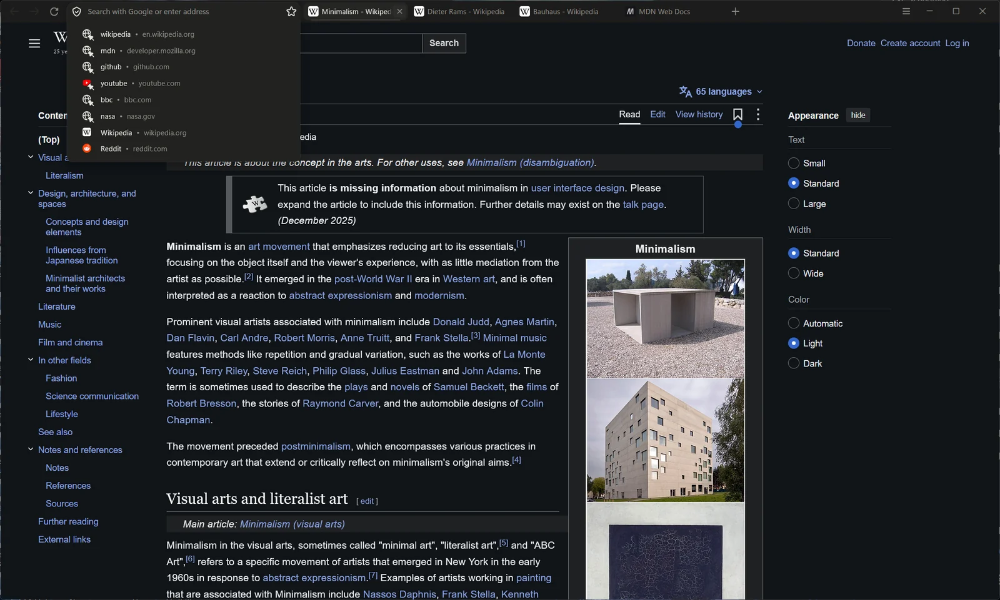
<p align="center"><b>Pinned sites</b><br><sub>Click into the empty address bar.</sub></p>
</td>
<td width="50%">
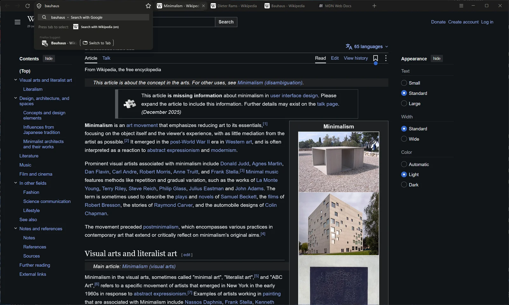
<p align="center"><b>Suggestions</b><br><sub>One line per result, flat, exactly as wide as the field.</sub></p>
</td>
</tr>
<tr>
<td width="50%">
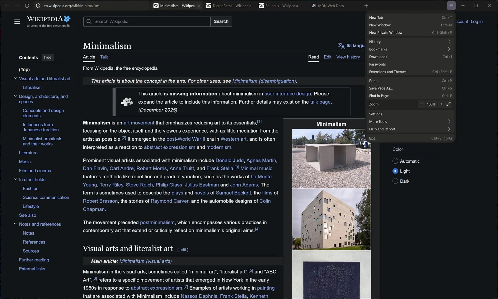
<p align="center"><b>☰ menu</b><br><sub>Compact rows, no sign-in banner, no lines.</sub></p>
</td>
<td width="50%">
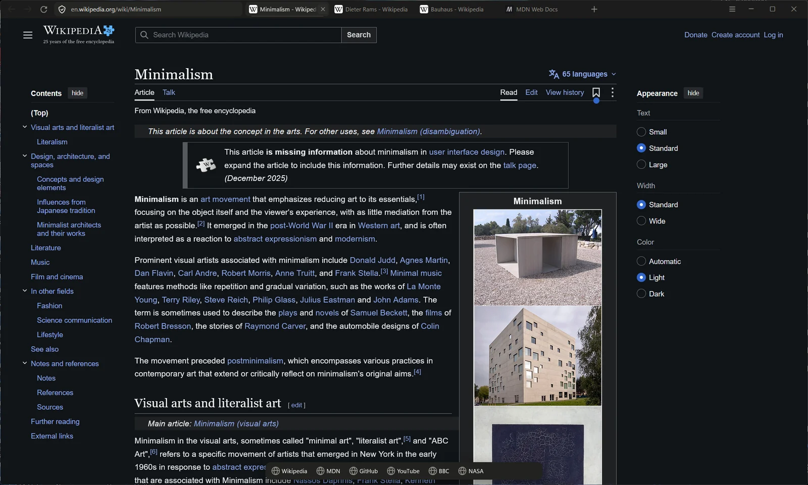
<p align="center"><b>Bookmarks bar</b><br><sub>Slides up when the mouse touches the bottom edge.</sub></p>
</td>
</tr>
<tr>
<td width="50%">
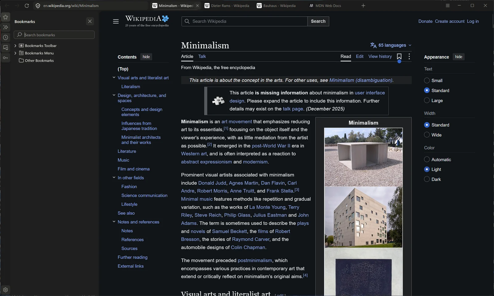
<p align="center"><b>Sidebar</b><br><sub>Off by default; <kbd>Ctrl</kbd>+<kbd>B</kbd> brings it back, styled to match.</sub></p>
</td>
<td width="50%">
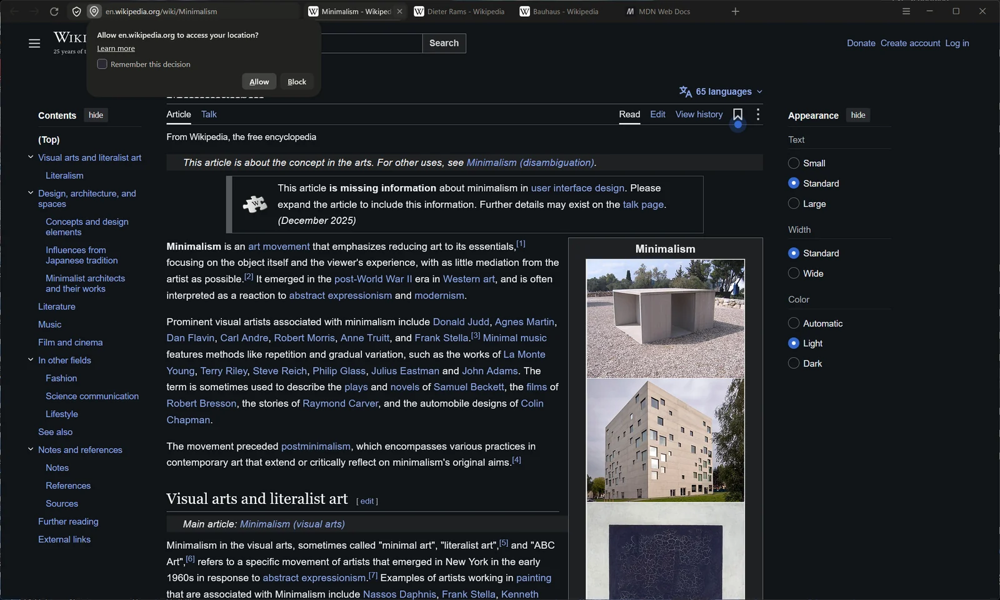
<p align="center"><b>Permission prompts</b><br><sub>Flat buttons; the main one is a faint white tint.</sub></p>
</td>
</tr>
<tr>
<td width="50%">
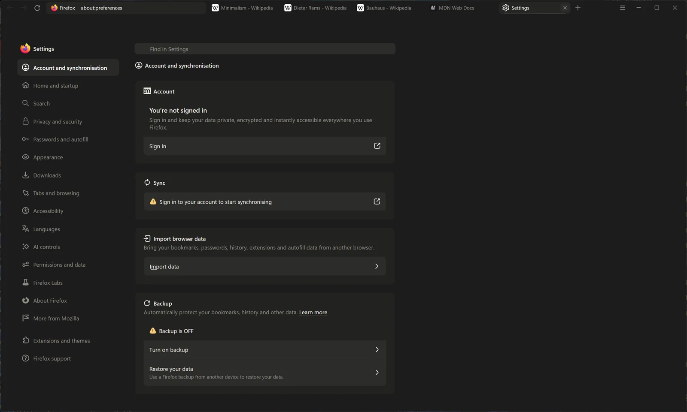
<p align="center"><b>Settings and Firefox's own pages</b><br><sub>Same tokens, one type size, a soft marker for the current section.</sub></p>
</td>
<td width="50%">
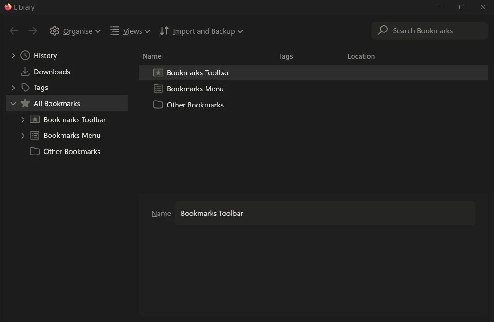
<p align="center"><b>Library window</b><br><sub>Manage bookmarks, History and Downloads: no blue, no lines.</sub></p>
</td>
</tr>
</table>

<details>
<summary><b>The installer</b> (click to expand)</summary>
<br>
<table>
<tr>
<td>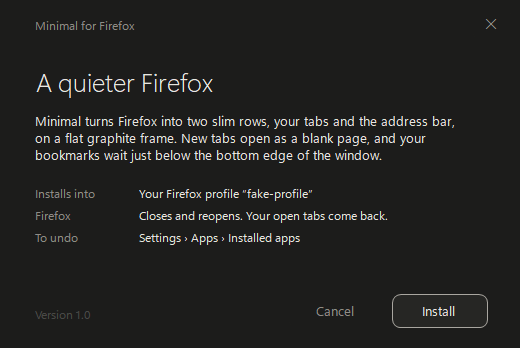</td>
<td>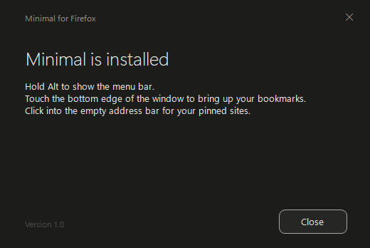</td>
</tr>
<tr>
<td>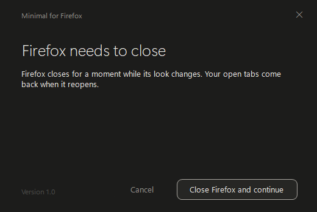</td>
<td>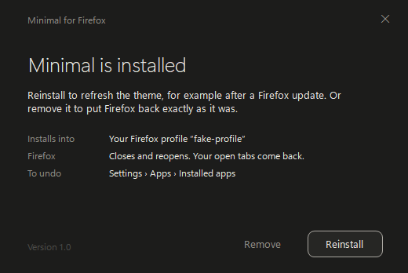</td>
</tr>
<tr>
<td>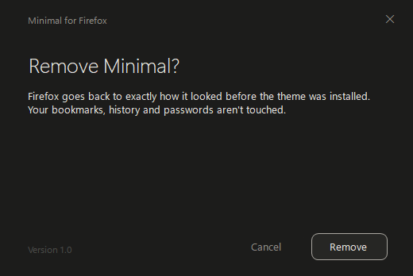</td>
<td>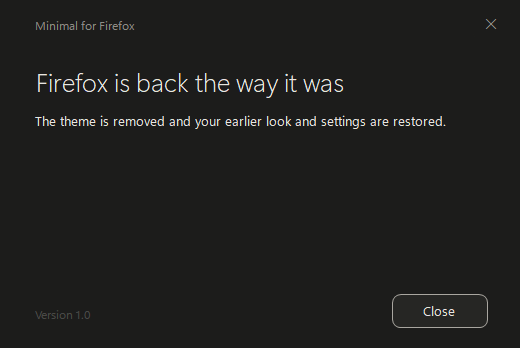</td>
</tr>
</table>
<sub>The installer's window uses the theme's own colours and type, so it previews what it installs.</sub>
</details>

<br>

## Install

### Windows: the installer

1. Download **`Minimal Firefox Theme Setup.exe`** from the [latest release](https://github.com/tomxander/firefox-themes/releases/latest).
2. Windows may say *"Windows protected your PC"* because the installer isn't code-signed. Click **More info**, then **Run anyway**.
3. Click **Install**. If Firefox is open it closes for a moment and reopens with your tabs.

To remove it: **Settings › Apps › Installed apps › Minimal theme for Firefox › Uninstall**. That puts Firefox back exactly as it was.

> [!NOTE]
> The installer backs up your current Firefox customisation first and keeps your own `user.js` settings. It's safe to run again after a Firefox update to refresh the theme, and it needs no admin rights because it installs only for you.

<details>
<summary><b>Tips once it's installed</b></summary>
<br>

| To | Do this |
|---|---|
| Show the menu bar | Hold <kbd>Alt</kbd> |
| Open a bookmark | Touch the bottom edge of the window |
| Open a pinned site | Click into the empty address bar |
| Open the sidebar | <kbd>Ctrl</kbd>+<kbd>B</kbd> |
| Get the Firefox menu | ☰ at the top right |

</details>

### Windows: all four themes, with a switcher

```powershell
powershell -ExecutionPolicy Bypass -File scripts\install-windows.ps1
```

This copies all four themes and the switcher into your Firefox profile and opens the switcher window. To switch later, run `chrome\themes\Switch-Theme.ps1` from the profile folder (a desktop shortcut to it works well). The switcher closes Firefox the way the X button does, so your session comes back. It copies the theme's files, clears the settings that themes manage so the next one starts clean, sets the menu bar and reopens Firefox.

```powershell
Switch-Theme.ps1 -List                     # list themes, * marks the current one
Switch-Theme.ps1 -Theme minimal            # apply a theme
Switch-Theme.ps1 -Theme luna-2026 -DryRun  # show what would change
```

### macOS and Linux

```bash
bash scripts/install-mac.sh minimal
```

Quit Firefox first. This copies one theme into your default profile; add `--profile <path>` for another one (Firefox lists them at `about:profiles`). To switch, run it again with another theme name.

> [!IMPORTANT]
> The macOS variant (section 20 of `themes/minimal/userChrome.css`) puts ☰ at the right edge, leaves room for the traffic lights and uses the system font. It hasn't been checked on a Mac yet ([#1](https://github.com/tomxander/firefox-themes/issues/1)).

<br>

## The other themes

The switcher also carries three earlier looks. They show the menu bar and keep Firefox's two-row layout.

| Folder | Name | The idea |
|---|---|---|
| [`themes/minimal`](themes/minimal) | **Minimal Dark** | Flat, colourless graphite in one slim row. The main theme. |
| [`themes/xp-classic`](themes/xp-classic) | XP Classic | Windows XP Luna: blue title bar, beige menu bar, a Bliss new tab page, XP icons and a status bar. |
| [`themes/luna-2026`](themes/luna-2026) | Luna 2026 | XP redesigned for 2026: smooth blue, rounded corners, flat icons, a frosted-glass new tab page. |
| [`themes/luna-mac`](themes/luna-mac) | Luna 2026 + Mac | Luna 2026 with traffic-light buttons, a centred title, a Safari-style address bar and Mac menus. |

<br>

## How it's built

There are no extensions and no scripts inside Firefox. Each theme is three files Firefox reads at startup from your profile folder:

```
themes/<name>/
├── userChrome.css    the browser itself: tabs, address bar and dropdown, menus, panels,
│                     sidebar, Library window, dialogs, prompts, tab previews
├── userContent.css   pages Firefox draws: new tab, Settings, Add-ons, error pages,
│                     Firefox View, Private Browsing
├── user.js           the preferences the theme needs, starting with
│                     toolkit.legacyUserProfileCustomizations.stylesheets
└── theme.json        name, description, menu bar and sort order for the switcher
```

### Design tokens

Everything in Minimal Dark comes from a handful of tokens at the top of [`themes/minimal/userChrome.css`](themes/minimal/userChrome.css).

| | Token | Value | Used for |
|---|---|---|---|
|  | `--m-frame` | `#1C1C1B` | window, tab strip |
|  | `--m-raised` | `#262624` | current tab, address field |
|  | `--m-popup` | `#222220` | menus, panels, dropdowns |
|  | `--m-text` | `#E8E6E1` | text |
|  | `--m-muted` | `#8F8C86` | secondary text, icons |
|  | `--m-faint` | `#5E5C58` | disabled |
| | `--m-accent` | `rgba(255,255,255,0.2)` | the one accent, always one device pixel (`--m-hair`) |

**Type:** Segoe UI Variable Text, 11.5px in the browser and 13px on Firefox's pages. Hierarchy comes from weight, not size.
**Shape:** radii of 4, 8 and 12. Controls are 28px tall in a 36px row.

### What it depends on in Firefox

It was written against Firefox 159 on Windows 11. A major Firefox update can move things, and these are the parts most likely to need attention:

- **The Nova address bar** (`browser.nova.enabled`) and its `--urlbar-*` variables.
- **`moz-*` web components** (cards, page navigation, buttons). Their shadow DOM can only be reached through CSS custom properties.
- **Separate documents** for the sidebar panels (`chrome://browser/content/sidebar/`) and the Library window (`places.xhtml`), each styled with `@-moz-document`.
- **Windows 11 menus**, forced to solid edge-to-edge popups to avoid the Mica dark box.
- **The window buttons**, which draw their glyphs with the Segoe Fluent Icons font. The theme pins that font so its own doesn't replace it.
- **☰ placement**, using `position: fixed`, measured from the window buttons' fixed 40px width.

`userChrome.css` is split into 20 numbered sections, so a change after a Firefox update can usually be found by section name.

<br>

## The installer

[`installer/`](installer) holds the sources for `Minimal Firefox Theme Setup.exe`. It's a small WinForms app (C# 5, .NET Framework 4) with the theme's three files embedded in it. To build it:

```powershell
powershell -ExecutionPolicy Bypass -File installer\build.ps1
```

This uses the `csc.exe` that ships with Windows, so there's nothing to install. The result goes to `installer\dist\`, and the script prints its size and SHA-256. A GitHub Action builds it on every push too (see the **Actions** tab). The version is `Engine.Version` in `Engine.cs` plus the assembly version in `Program.cs`.

<details>
<summary><b>Command-line switches</b> (for testing against a scratch profile)</summary>
<br>

| Switch | Effect |
|---|---|
| `/silent` | No window; exit code 0 means success |
| `/uninstall` | Remove instead of install |
| `/profile "<path>"` | Use this Firefox profile instead of the default one |
| `/nolaunch` | Don't reopen Firefox afterwards |
| `/noregister` | Don't add or remove the Installed apps entry |

</details>

<br>

## Known gaps

These are tracked as [issues](https://github.com/tomxander/firefox-themes/issues):

- **macOS** variant not yet checked on a Mac ([#1](https://github.com/tomxander/firefox-themes/issues/1)).
- **Error pages** still show Firefox's colour illustration, which lives inside a shadow DOM that `userContent.css` can't reach ([#2](https://github.com/tomxander/firefox-themes/issues/2)).
- **Add-ons page** recommendations show a colour illustration ([#3](https://github.com/tomxander/firefox-themes/issues/3)).
- **The switcher** is Windows only ([#7](https://github.com/tomxander/firefox-themes/issues/7)), and reopens Firefox with an extra blank tab ([#4](https://github.com/tomxander/firefox-themes/issues/4)).
- Holding <kbd>Alt</kbd> can make the menu bar cover ☰ ([#5](https://github.com/tomxander/firefox-themes/issues/5)).

See [CHANGELOG.md](CHANGELOG.md) for what changed in each version and [CONTRIBUTING.md](CONTRIBUTING.md) for how to work on the themes.

<br>

<div align="center">
<sub>Made by <a href="https://thomasalex.in">Thomas Alex</a>. Released under the <a href="LICENSE">MIT licence</a>.</sub>
</div>
